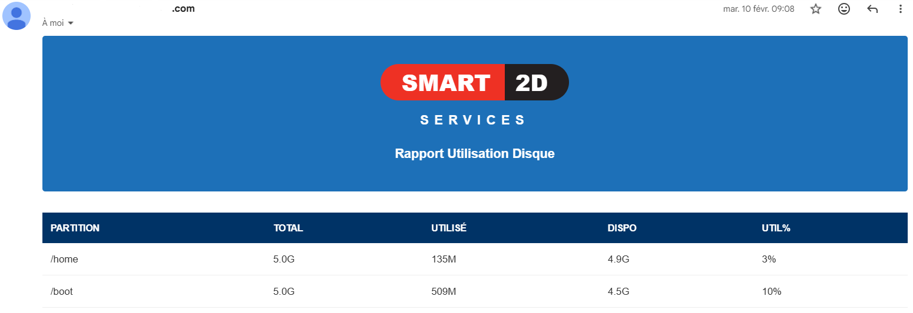

# Automated Server Health Monitor


A disk-usage monitor for Linux servers: a Python script checks the critical partitions, emails an HTML report through a self-hosted mail relay, and flags any partition that crosses an alert threshold.

## Overview

This project automates a routine but critical task: making sure a server never runs out of disk space unnoticed. It runs on a **self-administered infrastructure**: a Linux virtual machine with its own DNS server for internal name resolution and a Postfix MTA to deliver the reports.

## Tech Stack

* **Language:** Python 3.13, standard library only (`subprocess`, `smtplib`, `email`), no third-party dependency.
* **Infrastructure:**
    * **Postfix:** local Mail Transfer Agent (MTA) relaying the reports, with STARTTLS.
    * **DNS server:** self-hosted, for internal hostname resolution.
* **Environment:** Linux virtual machine, scheduled with `cron`; optional Docker image.

## Key Features

* **Storage analysis:** reads `df` for the partitions you choose (by default `/`, `/home` and `/boot`).
* **HTML email report:** one row per partition with total capacity, used space, available space and usage percentage, plus a plain-text version for clients that do not render HTML.
* **Threshold alerting:** a partition at or above the threshold (80 % by default) is highlighted in red, and the email subject is prefixed with `[ALERTE]`.
* **Scheduled runs:** started by `cron`, so reports arrive without anyone logging into the server.
* **Logging:** every run is written to a log file, including errors (SMTP failure, missing mount point).

## Sample Output

A report received in Gmail from the monitored server:



## Why This Matters

As an aspiring **Data Engineer**, I believe that observability is the backbone of any robust data architecture. By building the infrastructure (DNS/SMTP) myself before writing the automation, I learned how every link of the chain works, from name resolution to mail delivery. This project shows my ability to bridge **software development** and **system operations (DevOps)**.

## Configuration & Setup

1. **Clone the repository:**

   ```bash
   git clone https://github.com/AMENOUSSI/Automated-Server-Health-Monitor.git
   cd Automated-Server-Health-Monitor
   ```

2. **Create the configuration** from the example, then edit it:

   ```bash
   cp df_h_mail.json.example df_h_mail.json
   ```

   | Key | Meaning |
   |---|---|
   | `smtp.host`, `smtp.port` | Mail relay (e.g. the local Postfix on `localhost:25`, or a provider on port 587) |
   | `smtp.use_starttls`, `smtp.verify_tls` | Encrypt the connection, and check the server certificate |
   | `smtp.username`, `smtp.password` | Only if the relay requires authentication; leave empty for a local Postfix |
   | `email.from`, `email.to`, `email.subject` | Sender, recipients and subject of the report |
   | `email.organization`, `email.logo_path` | Name and logo shown in the report (optional) |
   | `filesystem.mountpoints` | Partitions to report, in display order |
   | `alert.threshold_percent` | Usage percentage that triggers an alert (default 80) |
   | `logging.file`, `logging.level` | Log file and level |

   Relative paths are resolved from the script's folder. `df_h_mail.json` is git-ignored: keep your credentials out of the repository.

3. **Run the script:**

   ```bash
   python3 ver2_mail.py
   ```

4. **Schedule it with cron**, for example every day at 8:00 (`crontab -e`):

   ```cron
   0 8 * * * /usr/bin/python3 /opt/Automated-Server-Health-Monitor/ver2_mail.py
   ```

## Run with Docker

1. **Build the image:**

   ```bash
   docker build -t server-monitor .
   ```

2. **Run the container.** A container only sees its own filesystem, so mount the host's root read-only and tell the script where it is with `HOST_ROOT`. `--network host` lets the container reach a Postfix listening on the host's `localhost`:

   ```bash
   docker run --rm --network host \
     -v /:/host:ro -e HOST_ROOT=/host \
     -v "$(pwd)/df_h_mail.json:/app/df_h_mail.json:ro" \
     server-monitor
   ```

## Tests

```bash
python3 -m unittest -v
```

The tests cover `df` parsing (order, mount points with spaces, fallback to `/`, Docker host prefix), the alert threshold and the inline logo.

## License

This project is open-source and available under the [MIT License](LICENSE).
